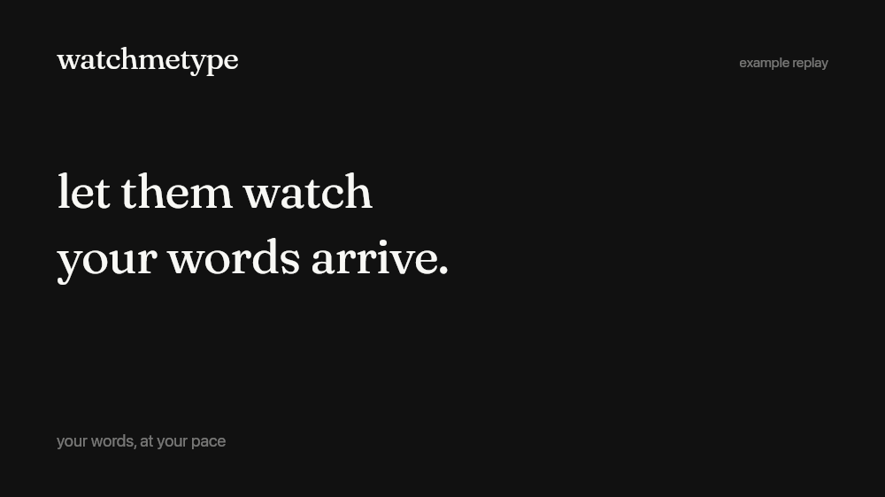

# watchmetype

let them watch your words arrive.

Write up to 500 characters, then share a link. Anyone who opens it can watch your post being typed—every pause, typo and edit.

[Try watchmetype](https://watchmetype.com/) · [How it works](https://watchmetype.com/about)

[](https://watchmetype.com/)

## How it works

Pasting is off. Deleted words stay in the replay. Viewers can pause, change the speed or skip to the end; long pauses are shortened during playback.

Share opens the device’s share sheet where available on mobile, or copies this message:

```text
Your post

watch it → full replay link
```

The recording lives after the `#` in the URL, which browsers don’t send to the server. There are no accounts, no post database and no analytics. Anyone with the full link, including an app you share it through, can access the recording.

Your draft and up to 50 recent shared posts are saved in this browser. Open your own link here to **continue editing**. Sharing again creates a new link; earlier links stay unchanged. Clearing site data removes the local drafts and history.

The writer and replay show the same last-edited date and time in GMT, to the minute. This comes from the writer’s device clock and travels in the link. Older links without a timestamp still play.

A replay is a witness, not a proof: it doesn’t establish who wrote the words, whether they’re original, or whether AI was involved.

Contributing or working on the code? Read [AGENTS.md](AGENTS.md) first.

## Run it

Needs Node.js 26+ for local tools and tests. Nothing to install. The site itself is plain HTML, CSS and ES modules, with no dependencies or compilation.

```bash
npm run dev      # http://localhost:8788
npm test         # run all tests
npm run preview  # build dist/ and serve it exactly as deployed
node tools/build.mjs --strict  # check assets and enforce size budgets
```

Type something, click **share**, then **watch it** to see the replay. Opening `index.html` from disk (`file://`) won’t work; use the dev server.

## Browser support

Recording and replay require `CompressionStream` and `DecompressionStream` with `deflate-raw` support. The site shows an update message when these are unavailable.

The layout supports light and dark mode, mobile viewport resizing and reduced motion. Real-device keyboard and social-app testing is still needed; see [AGENTS.md](AGENTS.md#known-gaps).

## Deployment and assets

Cloudflare Pages serves only the files listed in `tools/build.mjs`. Merging to `main` tests, packages a versioned release and deploys it to staging. Production receives the same bundle after manual approval. Use the **version** workflow for rollbacks.

Budgets: 20 KB gzipped code, 25 KB font and 50 KB first load. The README GIF in `docs/` is documentation only and isn’t deployed. Local marketing artwork stays in the ignored `marketing/` folder.

Social metadata requests a compact X card with the caret icon. There is no large promotional preview image; each receiving app controls how it displays a link.

## Removing a reported post

```bash
node tools/blockhash.mjs 'https://watchmetype.com/#1…'
```

Add the printed key to `blocklist.json` and release the change. The player checks the list when a replay opens and caches it for five minutes; it doesn’t poll while playing. Blocking playback on this site can’t erase copies of a recording.

Report a post by sending its full link to [report@watchmetype.com](mailto:report@watchmetype.com).

## Font

[Fraunces](https://github.com/undercasetype/Fraunces), SIL Open Font License (`fonts/OFL.txt`). Subset to weight 400, Latin only. Other scripts fall back to system fonts.
